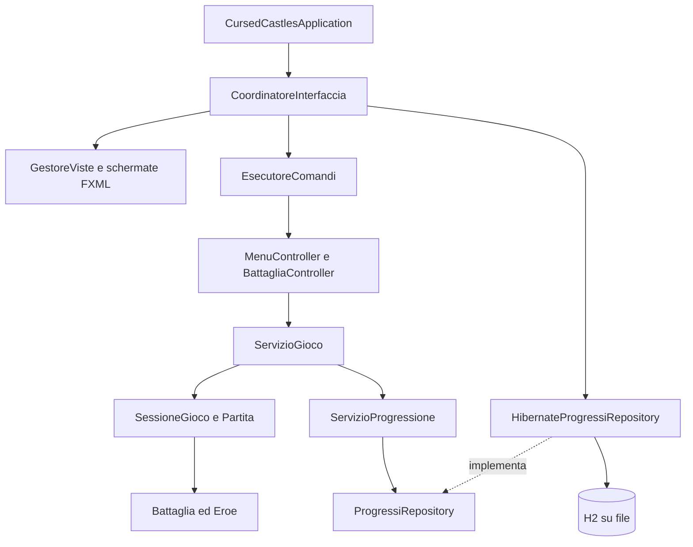

# Architettura

## Organizzazione generale

L'applicazione adotta una separazione tra Model, View e Controller, affiancata da servizi applicativi e da un livello di persistenza. Le regole di combattimento e avanzamento risiedono nel dominio; JavaFX presenta i risultati e raccoglie i comandi.

Il package base è `it.unicam.cs.mpgc.rpg125657.cursedcastles`.

| Package | Responsabilità |
| --- | --- |
| `model.personaggio` | Identità, vita, statistiche base e bonus. |
| `model.eroe` e `model.eroe.abilita` | Classi giocabili, creazione degli eroi e abilità. |
| `model.mostro` e `model.castello` | Tipi di mostro, nemici e configurazione dei castelli. |
| `model.combattimento` | Azioni, cure, ricariche e stati della battaglia. |
| `model.partita` | Campagna e passaggio ordinato tra i castelli. |
| `model.progressione` | Dati durevoli e contratto del repository. |
| `application` | Casi d'uso, sessione runtime e checkpoint. |
| `controller` | Comandi applicativi e snapshot per la vista. |
| `persistence.hibernate` | Entità, transazioni e configurazione Hibernate/H2. |
| `view` | Navigazione, schermate, componenti e risorse JavaFX. |

La freccia dal coordinatore al repository rappresenta il collegamento iniziale dei componenti: `CoordinatoreInterfaccia.avvia()` costruisce la `SessionFactory`, il repository, i servizi e i due controller. Durante il gioco i comandi passano attraverso controller e servizi.

## Dominio e servizi applicativi

`Partita` governa la sequenza dei castelli e prepara una nuova `Battaglia` a ogni ingresso. `Battaglia` controlla i turni e applica le strategie ricevute per attacco e cura. Le abilità e le statistiche mantengono lo stato specifico del singolo eroe.

`ServizioGioco` coordina la sessione attiva e il salvataggio delle vittorie. `ServizioProgressione` valida i riferimenti persistiti, ricostruisce l'eroe e avvia la campagna dal primo castello incompleto.

Nella configurazione predefinita, `ServizioProgressione` usa le classi giocabili di `ConfigurazioneEroe.tutte()` e la sequenza della campagna di `Castelli.tutti()`. In `Castelli`, le voci `ConfigurazioneNemici` associano i tipi di `ConfigurazioneMostro` alle quantità previste per ciascun castello. `FabbricaNemiciStandard` usa queste voci per creare gli avversari all'ingresso nel castello.

Il modello non dipende da JavaFX o dalle entità Hibernate. `ProgressiRepository` è il contratto che collega i servizi ai dati persistenti.

## Controller e snapshot

`MenuController` espone creazione, continuazione e cancellazione. `BattagliaController` espone attacco, abilità, cura, risposta nemica, salvataggio e avanzamento.

La vista riceve record e liste immutabili, tra cui `VistaPartita`, `StatoEroe`, `StatoCastello`, `StatoNemico` ed `EsitoComando`. In questo modo non modifica direttamente i combattenti mutabili.

Le classi `SchermataMenu`, `SchermataNuovaPartita` e `SchermataBattaglia` gestiscono i controlli FXML e gli eventi di presentazione. I controller dei casi d'uso sono le classi del package `controller`.

## Esecuzione dei comandi

`EsecutoreComandi` usa un executor con un solo thread per serializzare accessi alla sessione e al database. I risultati vengono consegnati al thread JavaFX tramite `Platform.runLater`.

La pausa di 650 ms della risposta nemica è gestita da `PauseTransition`, senza sospendere il thread grafico. La chiusura della `SessionFactory` viene accodata dopo i comandi già inviati.

## Moduli e distribuzione

Il [descrittore JPMS](https://github.com/Manu24life/Chronicles-of-the-Cursed-Castles/blob/main/src/main/java/module-info.java) dichiara le dipendenze e le aperture mirate richieste da FXML e Hibernate. La build configura `jlink` per produrre un runtime autonomo, includendo gli SPI Hibernate e le aperture modulari necessarie al launcher.

I dettagli dei contratti sono in [Interfacce e Astrazioni](Interfacce-e-Astrazioni); lo schema durevole è in [Persistenza dei Dati](Persistenza-dei-Dati).
