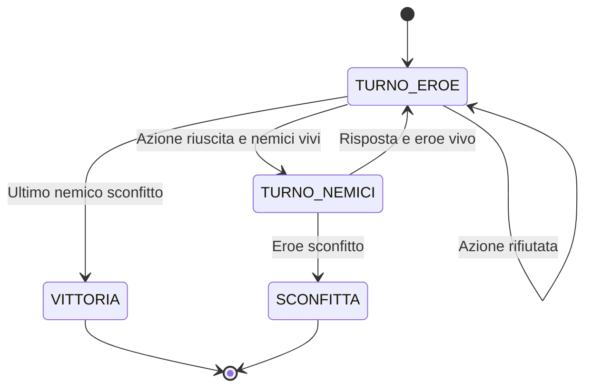

# Funzionalità

## Creazione e gestione della partita

Il menu permette di creare una nuova partita, continuare dal checkpoint ed eliminare il salvataggio. Se la sessione è ancora in memoria, il comando **Riprendi lo scontro** riapre lo stato corrente.

La creazione richiede un nome non vuoto, normalizzato eliminando gli spazi iniziali e finali, lungo al massimo 100 caratteri, e una classe del catalogo. Esiste un solo slot: la sostituzione di un salvataggio richiede conferma nell'interfaccia.

## Classi dell'eroe

| Classe | Vita massima | Attacco base | Difesa base | Abilità |
| --- | ---: | ---: | ---: | --- |
| Mago | 80 | 24 | 4 | Assorbimento magico |
| Cavaliere | 120 | 17 | 9 | Tempra del cavaliere |

**Assorbimento magico** richiede un nemico vivo: infligge 8 danni, limitati alla vita residua del bersaglio, e recupera il 30% della vita massima del Mago, cioè fino a 24 punti. Questo danno speciale non sottrae la difesa del bersaglio.

**Tempra del cavaliere** non richiede un bersaglio: aggiunge il 15% all'attacco e il 40% alla difesa. I bonus si accumulano in modo additivo sulle statistiche base e durano per il castello corrente. Due utilizzi producono complessivamente +30% attacco e +80% difesa; i valori risultanti sono arrotondati all'intero più vicino.

Entrambe le abilità iniziano disponibili. Dopo l'uso la ricarica è impostata a 3 e diminuisce al termine di ciascuna risposta nemica, quando inizia il nuovo turno dell'eroe. Anche la risposta immediatamente successiva all'abilità fa avanzare la ricarica.

## Campagna e nemici

| Ordine | Castello | Codice | Avversari |
| --- | --- | --- | --- |
| 1 | Castello delle Ossa | `ossa` | 3 scheletri |
| 2 | Fortezza di Ferro | `ferro` | 2 orchi e 1 vampiro |
| 3 | Rocca della Maledizione | `maledizione` | 1 drago |

| Nemico | Vita | Attacco | Difesa |
| --- | ---: | ---: | ---: |
| Scheletro | 35 | 14 | 2 |
| Orco | 65 | 20 | 5 |
| Vampiro | 70 | 26 | 7 |
| Drago | 320 | 30 | 12 |

Ogni ingresso in un castello crea nuove istanze degli avversari. I tipi di mostro definiscono statistiche e identità; i nemici usano l'attacco configurato per la battaglia.

## Combattimento a turni

L'eroe può attaccare un nemico vivo, usare l'abilità oppure curarsi. L'attacco standard calcola:

```text
danno = max(1, attacco dell'esecutore - difesa del bersaglio)
danno effettivo = min(danno, vita residua del bersaglio)
```

Dopo un'azione riuscita risponde **un solo nemico**:

- Dopo un attacco o un'abilità con bersaglio risponde il bersaglio, se è ancora vivo; altrimenti il primo nemico vivo della lista.
- Dopo una cura o l'abilità del Cavaliere risponde il primo nemico vivo.
- Se l'ultimo nemico viene sconfitto, la battaglia termina con una vittoria e non c'è risposta.

Un'azione rifiutata, per esempio una cura a vita piena o un'abilità in ricarica, non consuma il turno. Nell'interfaccia la risposta viene avviata dopo una pausa di 650 ms.



## Cure e passaggio tra castelli

La cura standard è utilizzabile **due volte per castello** e recupera il **5% della vita massima**, senza superarla: fino a 4 punti per il Mago o 6 per il Cavaliere. Il consumo avviene solo se la cura riesce.

All'ingresso in un nuovo castello vengono ripristinati la vita massima, le due cure e la disponibilità iniziale dell'abilità. I bonus accumulati vengono azzerati.

Una vittoria aggiorna automaticamente il checkpoint. Il giocatore avanza con un comando esplicito; dopo l'ultimo castello il comando conclude la campagna. Se la scrittura fallisce, può ritentarla conservando la vittoria in memoria.

## Ripresa e limiti attuali

Il checkpoint conserva nome, codice della classe e codici dei castelli completati. Dopo la chiusura dell'applicazione si riparte dal primo castello incompleto con una nuova battaglia. Il salvataggio non comprende vita residua, bonus, ricariche o azioni dello scontro interrotto.

Inventario, equipaggiamento, esplorazione libera, dialoghi narrativi, audio e impostazioni persistenti non sono implementati. Le proposte relative a queste funzionalità sono in [Miglioramenti Futuri](Miglioramenti-Futuri).

I dati e le regole sono definiti in [ConfigurazioneEroe](https://github.com/Manu24life/Chronicles-of-the-Cursed-Castles/blob/main/src/main/java/it/unicam/cs/mpgc/rpg125657/cursedcastles/model/eroe/ConfigurazioneEroe.java), [ConfigurazioneMostro](https://github.com/Manu24life/Chronicles-of-the-Cursed-Castles/blob/main/src/main/java/it/unicam/cs/mpgc/rpg125657/cursedcastles/model/mostro/ConfigurazioneMostro.java), [Castelli](https://github.com/Manu24life/Chronicles-of-the-Cursed-Castles/blob/main/src/main/java/it/unicam/cs/mpgc/rpg125657/cursedcastles/model/castello/Castelli.java) e [Battaglia](https://github.com/Manu24life/Chronicles-of-the-Cursed-Castles/blob/main/src/main/java/it/unicam/cs/mpgc/rpg125657/cursedcastles/model/combattimento/Battaglia.java).
