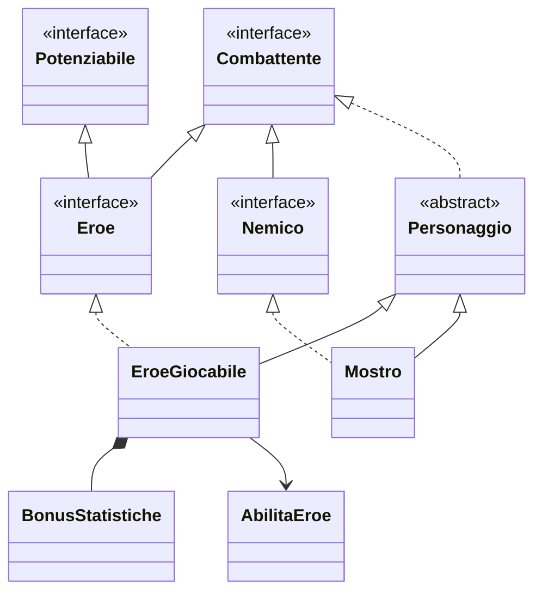

# Interfacce e Astrazioni

## Contratti del dominio

| Interfaccia | Ruolo | Implementazione o utilizzo |
| --- | --- | --- |
| `Combattente` | Identità, statistiche, vita, danno e recupero di un partecipante allo scontro. | `Personaggio` fornisce la base comune; `Eroe` e `Nemico` specializzano il contratto. |
| `Potenziabile` | Applicazione, lettura e azzeramento dei bonus. | È estesa da `Eroe` e realizzata da `EroeGiocabile`. |
| `Eroe` | Classe, abilità e preparazione dell'eroe tra i castelli. | `EroeGiocabile`. |
| `Nemico` | Combattente associato a un tipo di mostro. | `Mostro`. |
| `AzioneCombattimento` | Esecuzione di un'azione tra due combattenti. | `AttaccoBase`; strategie ricevute da `Battaglia` e `Partita`. |
| `AbilitaEroe` | Nome, requisiti del bersaglio, utilizzo e stato dell'abilità. | `AbilitaConRicarica`, specializzata nelle due abilità iniziali. |
| `Ricarica` | Politica di disponibilità e consumo dell'abilità. | `RicaricaATurni`. |
| `RegolaCura` | Cura dell'eroe e numero di utilizzi rimanenti. | `CuraPercentualeLimitata`. |

Questi contratti permettono alle regole di lavorare con capacità specifiche. L'attacco usa `Combattente`; la gestione della battaglia usa `Eroe` e `Nemico`; la ricarica viene delegata a un oggetto dedicato.



Il diagramma riassume le relazioni principali; non elenca tutti i metodi e i record del modello.

## Fabbriche

| Contratto | Scopo |
| --- | --- |
| `FabbricaEroi` | Creare un eroe a partire da nome e classe; l'implementazione iniziale è `FabbricaEroiStandard`. |
| `FabbricaNemici` | Creare gli avversari di un castello; l'implementazione iniziale è `FabbricaNemiciStandard`. |
| `FabbricaAbilitaEroe` | Produrre una nuova abilità per ogni eroe della classe. |
| `FabbricaRegolaCura` | Produrre una regola di cura indipendente per ogni castello. |

La creazione di istanze separate impedisce che due eroi condividano una ricarica o che due castelli condividano il contatore delle cure.

## Repository

`ProgressiRepository` definisce tre operazioni:

```java
Optional<ProgressiPartita> carica();
void sostituisci(ProgressiPartita progressi);
void elimina();
```

`ServizioProgressione` dipende da questo contratto. L'implementazione di produzione è `HibernateProgressiRepository`; i test possono fornire repository in memoria o con errori simulati senza cambiare i servizi.

## Classi astratte e composizione

`Personaggio` concentra le regole comuni sulla vita. `AbilitaConRicarica` definisce il flusso condiviso di un'abilità, demandando alle sottoclassi l'effetto concreto.

Il comportamento variabile viene anche composto: `EroeGiocabile` riceve la propria abilità; `AbilitaConRicarica` riceve una `Ricarica`; `Battaglia` riceve strategie di attacco e cura. La scelta di una classe dell'eroe dipende dalla sua configurazione, senza richiedere una sottoclasse di personaggio per ogni classe giocabile.

Fonti: [dominio](https://github.com/Manu24life/Chronicles-of-the-Cursed-Castles/tree/main/src/main/java/it/unicam/cs/mpgc/rpg125657/cursedcastles/model) e [repository Hibernate](https://github.com/Manu24life/Chronicles-of-the-Cursed-Castles/blob/main/src/main/java/it/unicam/cs/mpgc/rpg125657/cursedcastles/persistence/hibernate/HibernateProgressiRepository.java).
