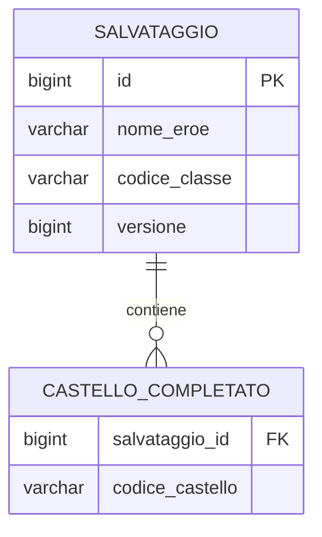
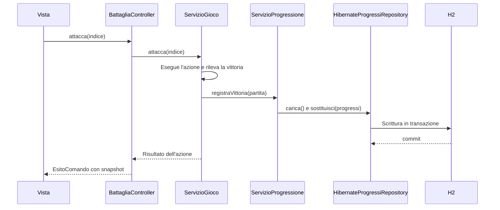

# Persistenza dei Dati

## Tecnologia e posizione del database

Il progetto usa **Hibernate ORM 7.4.12.Final** per il mapping relazionale e **H2 2.5.250** come database embedded su file. Non è necessario avviare un server separato.

Il percorso predefinito è:

```text
<user.home>/.cursed-castles/salvataggio.mv.db
```

`HibernateSessionFactory` crea la directory, configura la connessione e registra `SalvataggioEntity`. La modalità di gestione dello schema usata per il database su file è `update`.

## Dati conservati

Esiste un solo slot con identificativo `1`. Il valore di dominio `ProgressiPartita` contiene nome dell'eroe, codice della classe e insieme dei codici dei castelli completati.

| Dato | Persistito | Comportamento alla ripresa |
| --- | --- | --- |
| Nome e codice della classe | Sì | Vengono usati per ricreare l'eroe. |
| Castelli completati | Sì | Individuano il primo castello incompleto. |
| Vita residua e nemici danneggiati | No | La battaglia viene ricreata dall'inizio. |
| Bonus e ricarica dell'abilità | No | Sono ripristinati per l'ingresso nel castello. |
| Cure consumate | No | La nuova battaglia riceve due cure. |
| Registro degli eventi della vista | No | Viene ricreato durante la sessione. |

**Riprendi lo scontro** usa la sessione ancora aperta in memoria. **Continua dal checkpoint**, dopo un riavvio, ricostruisce una nuova partita dai soli dati durevoli.

## Schema relazionale



`nome_eroe` è obbligatorio e lungo al massimo 100 caratteri; i codici hanno lunghezza massima 64 nel mapping. La coppia `(salvataggio_id, codice_castello)` è univoca. Il campo `versione`, annotato con `@Version`, permette a Hibernate di rilevare aggiornamenti concorrenti dello slot.

Il codice della classe e quelli dei castelli fanno riferimento ai cataloghi usati da `ServizioProgressione`, forniti per impostazione predefinita da `ConfigurazioneEroe.tutte()` e `Castelli.tutti()`. `SalvataggioEntity` è interna al package di persistenza e converte i dati nel record immutabile del dominio.

## Flusso di salvataggio

1. Una nuova partita viene costruita e validata prima di sostituire lo slot precedente.
2. Dopo una vittoria, `ServizioGioco` richiede a `ServizioProgressione` di registrare il castello completato.
3. Il repository inserisce o aggiorna lo slot dentro una transazione.
4. L'avanzamento diventa disponibile dopo il salvataggio riuscito.



Il diagramma mostra il caso in cui l'attacco sconfigge l'ultimo nemico e la scrittura riesce. Se la scrittura fallisce, la vittoria resta nella sessione e **Riprova salvataggio** ritenta soltanto il checkpoint. Dopo un riavvio è disponibile l'ultimo checkpoint effettivamente scritto.

## Integrità ed errori

`ProgressiPartita` normalizza il nome, valida il formato dei codici e copia l'insieme dei castelli in forma immutabile. `ServizioProgressione` controlla che classe e castelli esistano nei cataloghi e che i castelli completati costituiscano un prefisso valido della campagna.

Il repository apre una sessione per operazione, esegue commit o rollback e chiude la sessione. Gli errori vengono tradotti in `EccezionePersistenza`; un eventuale errore di rollback viene conservato come eccezione soppressa, senza perdere la causa originale.

## Database separato per le prove

La proprietà JVM `cursedcastles.database` specifica un percorso senza estensione. Esempio PowerShell:

```powershell
$opzioniPrecedenti = $env:JAVA_TOOL_OPTIONS
try {
    $env:JAVA_TOOL_OPTIONS = "$opzioniPrecedenti -Dcursedcastles.database=build/ui-smoke/salvataggio".Trim()
    .\gradlew.bat run
} finally {
    if ($null -eq $opzioniPrecedenti) {
        Remove-Item Env:JAVA_TOOL_OPTIONS -ErrorAction SilentlyContinue
    } else {
        $env:JAVA_TOOL_OPTIONS = $opzioniPrecedenti
    }
}
```

Questo esempio conserva le eventuali opzioni JVM già impostate e ripristina la variabile al termine della prova. I test del repository usano database dedicati e non aprono lo slot personale.

Fonti: [persistenza Hibernate](https://github.com/Manu24life/Chronicles-of-the-Cursed-Castles/tree/main/src/main/java/it/unicam/cs/mpgc/rpg125657/cursedcastles/persistence/hibernate) e [servizio di progressione](https://github.com/Manu24life/Chronicles-of-the-Cursed-Castles/blob/main/src/main/java/it/unicam/cs/mpgc/rpg125657/cursedcastles/application/ServizioProgressione.java).
